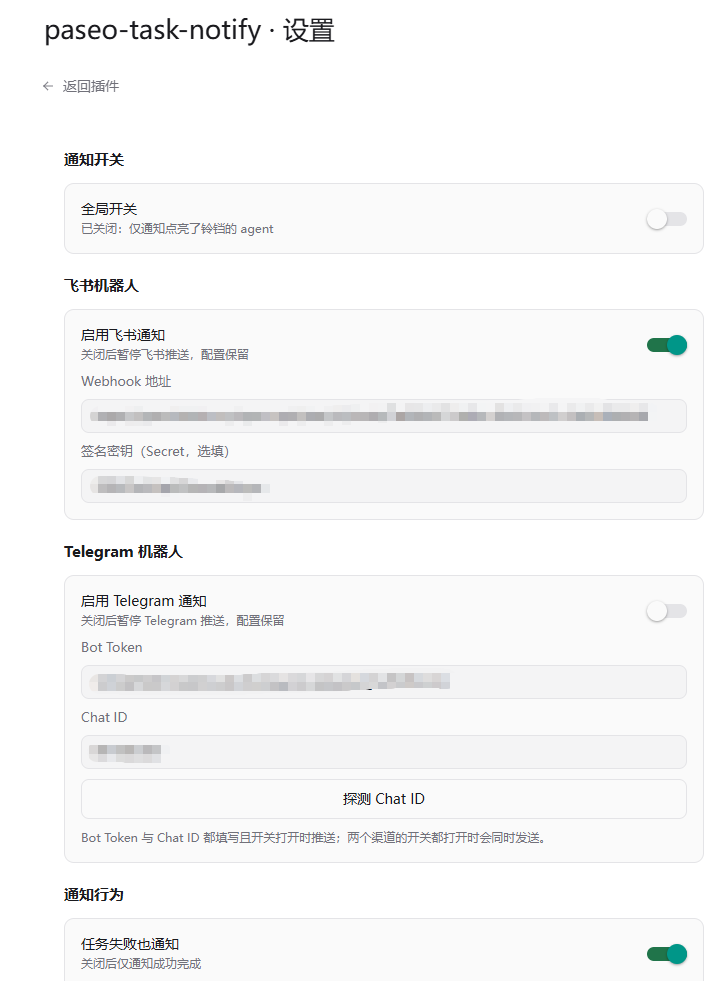
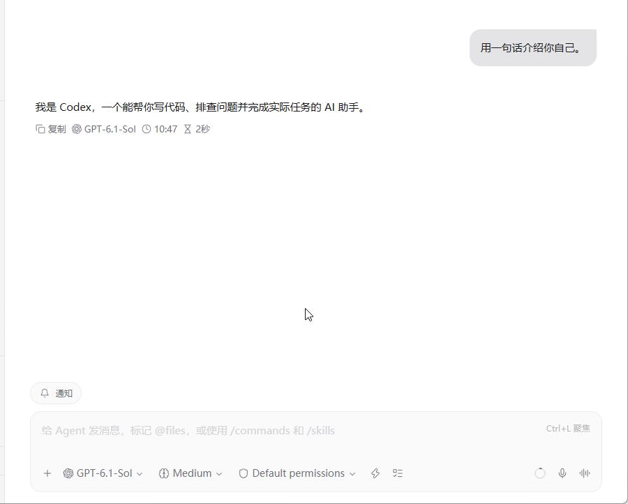
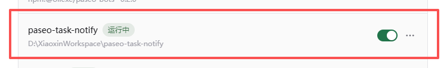

English | [简体中文](README.md)

# paseo-task-notify

Paseo task completion notification plugin. **Only speaks up when the main task is done**, with Feishu and Telegram channels, quiet by default and enabled on demand.

[](https://paseo.sh/docs/plugins)
[](./LICENSE)

## Screenshots

**Plugin settings page** (independent channel switches, Feishu / Telegram configuration, notification behavior)



**Notification bell beside the agent composer** (light it up to enable notifications for that agent)



**Running in the plugin list after installation**



## Background

Long tasks in paseo (large refactors, batch edits, test runs) often take from ten minutes to several hours. You cannot stare at the screen the whole time, but you also do not know when the task ends, whether it failed, or whether it is stuck waiting for permission.

Before the official plugin system existed, the community solution was a standalone polling program (such as [paseo-notifier](https://github.com/winezer0/paseo-notifier)): register a system service that stays resident, poll the daemon's MCP API every 5 seconds, and push every observed state change. In practice it had a few rough edges:

- Too wide an event surface: subagent completions, running heartbeats, stuck detection, and disconnect/reconnect events all push, and the phone keeps buzzing
- No runtime switch: to mute temporarily you have to edit the config and restart the service
- Polling adds seconds of latency, and you have to maintain an extra resident service

This plugin redoes the job with the official paseo plugin system.

## Problems it solves

| Problem | Solution |
| --- | --- |
| Too many intermediate notifications | It only listens to top-level agent turn-end events; subagent turn ends are never announced |
| No on-demand switch | Everything is off by default; the bell button enables one agent, `/notify on/off` switches globally |
| Failed or blocked tasks go unnoticed | Task failures and pending permission requests (the task is stuck waiting for you) are announced too |
| Only one notification channel | Feishu and Telegram channels with independent switches, one or both, in parallel |
| Extra resident service to maintain | Runs as a daemon plugin subprocess, starts with paseo, no separate service |

## Features

- **Precise event semantics**: built on the `agent.turn_ended` lifecycle hook (completed / failed / canceled), so notifications are immediate with no polling delay; `parentAgentId` filtering means subagents never interrupt you
- **Quiet first**: fully off by default, notifications start when you light up the bell; short tasks (finished within 60 seconds by default) stay silent and the threshold is adjustable
- **Meaningful messages**: each notification carries a task summary (the last assistant message of the turn, truncated to 400 characters) and the elapsed time
- **Independent channel switches**: Feishu custom bot (signing verification supported) and Telegram bot; a channel delivers only when its switch is on and its configuration is complete, and one channel failing does not affect the other
- **One-click Telegram chat id probe**: enter the bot token, click once, and the plugin calls `getUpdates` to find the chat and fill it in, no manual JSON digging
- **Configured entirely in the app**: the settings page covers webhook, secret, threshold, and event switches, and "send test message" reports the result per channel
- **Non-invasive**: does not modify paseo itself, listens on no ports, reads no extra files, and only makes outbound HTTPS requests to the webhook addresses you configure

## Installation

Requirements: [paseo](https://paseo.sh) ≥ 0.14.0 with plugins enabled (**Settings → Plugins → Enable plugins**).

**Option 1: install from GitHub (recommended)**

```bash
paseo plugin install github:xztsummer/paseo-task-notify
```

**Option 2: download a release package**

1. Download the latest `paseo-task-notify-vX.Y.Z.zip` from [Releases](https://github.com/xztsummer/paseo-task-notify/releases) and extract it
2. Install the extracted directory:

```bash
paseo plugin install /path/to/paseo-task-notify
```

**Option 3: install from source**

```bash
git clone https://github.com/xztsummer/paseo-task-notify.git
paseo plugin install ./paseo-task-notify
```

## Configuration

After installation open **Settings → Plugins → paseo-task-notify → Settings**:

1. **Notification switches**: the global switch plus the 🔔 bell button beside each agent composer (per-agent enablement, the recommended daily workflow)
2. **Feishu bot**: add a custom bot in a Feishu group chat, then enter its webhook URL and signing secret (optional)
3. **Telegram bot**: create a bot via @BotFather → **send the bot a message** (such as `/start`, required, otherwise the bot cannot message you) → enter the token → click "probe chat id" to fill in the chat automatically
4. **Behavior**: whether to notify on task failures / pending permission requests, the minimum task duration (60 seconds by default), and the title prefix (distinguishes machines that push to the same destination, e.g. `MBP` turns the title into `[MBP] ✅ Task completed…`; leave empty to disable)
5. Click "send test message" to verify connectivity

Slash commands: `/notify on` enables everything globally, `/notify off` turns everything off (and clears per-agent bells), any other argument opens the settings page. The global switch can also be toggled from the command center (Ctrl+K).

## How it works

The server subscribes to paseo daemon lifecycle events: `agent.turn_started` (records when a turn starts), `agent.turn_ended` (completion and failure notifications), and `agent.permission_requested` (pending-permission notifications, deduplicated by request id and cleaned up on `agent.permission_resolved`).

A notification passes four gates in order: top-level agent (empty `parentAgentId`) → notification switch (global on or that agent's bell lit) → event type (completion / failure / pending permission) → minimum duration. Then it takes the last assistant message from the timeline tail as the summary and delivers to every enabled channel in parallel. A send failure is only logged in the plugin log and never affects the other channels or the hook chain.

To diagnose "why did I not get a notification": run `paseo plugin logs paseo-task-notify`. Every turn end leaves one decision log line (gate parameters, duration filter, delivery result).

## Privacy and permissions

- The plugin makes HTTPS requests only to the configured Feishu webhook URL and the Telegram Bot API (api.telegram.org), and listens on no ports
- Webhooks, secrets, and other configuration are stored in the local paseo home plugin settings file (`plugin-settings/paseo-task-notify/notify.json`) and are not uploaded to any third party
- Switch state is stored in `plugin-data/paseo-task-notify/state.json` and contains only agent ids and booleans

## Development

```bash
npm install
npm run typecheck
paseo plugin reload paseo-task-notify   # applies code changes; do not restart the daemon
```

### Updating without losing configuration

- For routine updates use `paseo plugin update paseo-task-notify` (replaces the code, keeps the configuration); after local edits use `paseo plugin reload`. **Do not use `paseo plugin remove`**, it deletes `plugin-settings/paseo-task-notify/notify.json` (Feishu webhook, Telegram token, and other settings are lost with no way to recover)
- Back up before big changes: `scripts/backup-config.sh` (backs up to `~/.paseo/plugin-backups/paseo-task-notify/<timestamp>/`), restore with `scripts/restore-config.sh <backup directory>`
- Configuration files: `~/.paseo/plugin-settings/paseo-task-notify/notify.json` (channel parameters), `~/.paseo/plugin-data/paseo-task-notify/state.json` (bell switches, not deleted by `remove`)

### Releasing

Change the `version` in `package.json` and push to `main`, and `.github/workflows/release.yml` will automatically tag `vX.Y.Z`, package `paseo-task-notify-vX.Y.Z.zip` in the historical format (top-level directory, without `assets/`), and create a GitHub Release with auto-generated changelog and the attachment. **To release, bump the version**; pushes without a version change do not trigger it, and re-running the same version is skipped automatically.

Project structure:

```
index.server.ts / index.client.tsx   # dual entry (daemon subprocess / app)
shared/     # RPC contracts and settings schema (zod)
server/     # lifecycle hooks, gates, Feishu/Telegram delivery, switch state
client/     # composer bell, settings page, switch state broadcast
```

Known limitations: the interface text is in Chinese; when the daemon stops the plugin goes offline with it, and no tasks run in that state anyway.

## License

[MIT](./LICENSE)
