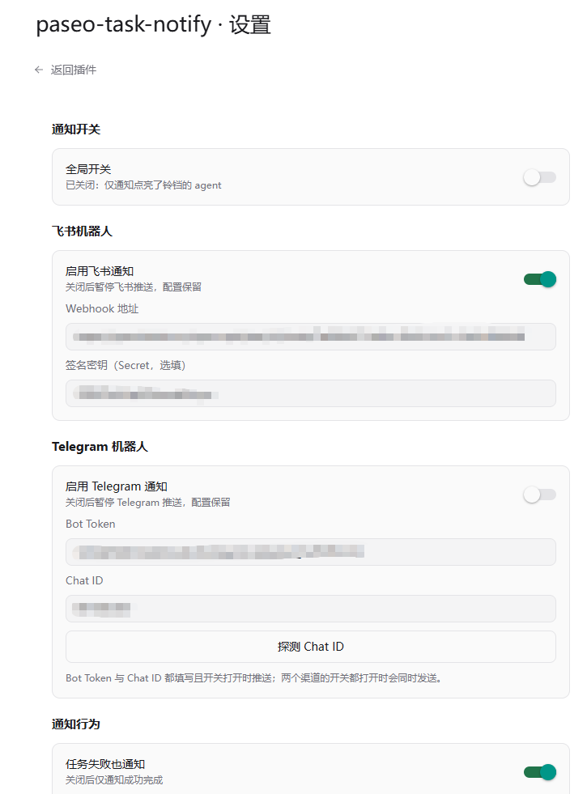
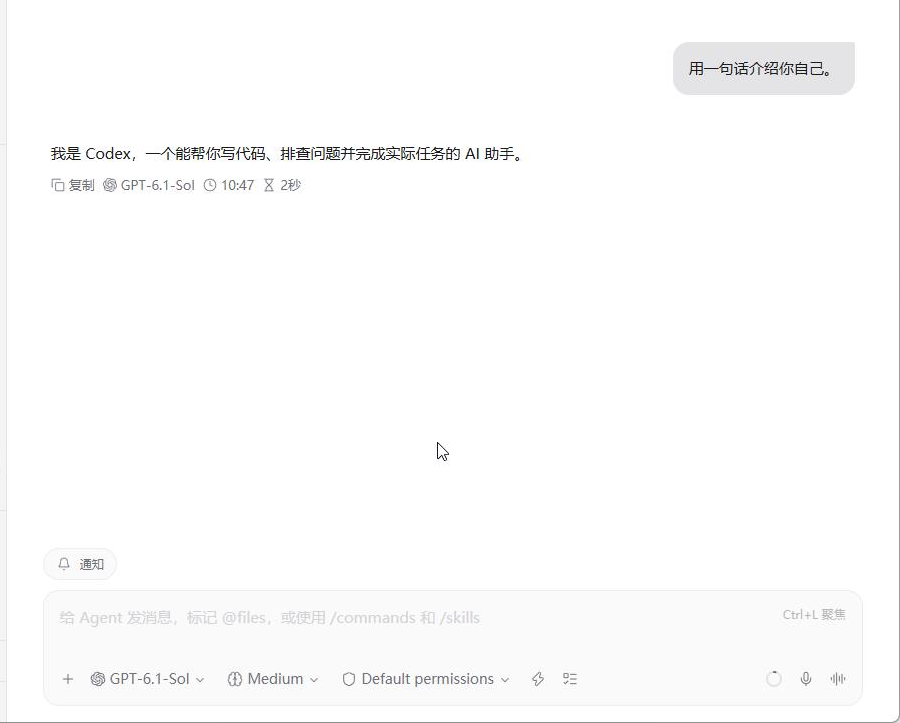
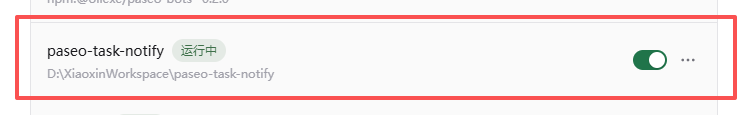

# paseo-task-notify

paseo 任务完成通知插件 —— **主任务跑完才通知你**，飞书 / Telegram 双渠道，默认安静、按需开启。

[](https://paseo.sh/docs/plugins)
[](./LICENSE)

## 截图

**插件设置页**（渠道独立开关、飞书 / Telegram 配置、通知行为）



**agent 输入框旁的通知铃铛**（点亮即开启该 agent 的任务完成通知）



**安装后在插件列表中运行**



## 背景

paseo 里跑的长任务（大重构、批量修改、跑测试）经常一跑就是十几分钟到几个小时。人不可能一直盯着屏幕，但又不知道任务什么时候结束、有没有失败、是不是卡在等授权。

在官方插件体系出现之前，社区的做法是独立的外部轮询程序（如 [paseo-notifier](https://github.com/winezer0/paseo-notifier)）：注册成系统服务常驻，每 5 秒轮询 daemon 的 MCP API，把观察到的状态变化都推出去。实测下来有几处不顺手：

- 事件面太宽：子任务完成、运行心跳、卡死检测、断线重连全都推送，手机响个不停
- 没有运行时开关，想临时静音只能改配置再重启服务
- 轮询有秒级延迟，还要单独维护一个常驻服务

这个插件用 paseo 官方插件体系把这件事重做了一遍。

## 解决的痛点

| 痛点 | 解法 |
| --- | --- |
| 中间过程通知太多 | 只监听主 agent 的回合结束事件，子代理（subagent）的回合结束一律不通知 |
| 不能按需开关 | 默认全关；铃铛按钮按 agent 开启，`/notify on/off` 全局切换 |
| 任务失败/被阻塞了不知道 | 任务失败、等待授权（任务卡住等你确认）也会通知 |
| 通知渠道单一 | 飞书 + Telegram 双渠道，各自独立开关，可单发也可并行 |
| 要维护额外的常驻服务 | 以 daemon 子进程运行，随 paseo 自启，无需单独安装服务 |

## 功能特色

- **精确的事件语义**：基于 `agent.turn_ended` 生命周期钩子（成功 / 失败 / 取消三态结果），事件即达、无轮询延迟；按 `parentAgentId` 过滤，子代理永远不会打扰你
- **安静优先**：默认全部关闭，点亮铃铛才开始通知；短任务（默认 60 秒内完成）自动静音，阈值可调
- **消息有内容**：通知自带任务摘要（时间线最后一条助手消息，截断 400 字）与用时
- **双渠道独立开关**：飞书自定义机器人（支持签名校验）+ Telegram Bot；「开关开启且配置齐全」才投递，单渠道失败不影响另一个
- **Telegram Chat ID 一键探测**：填好 Bot Token 点一下，自动调 `getUpdates` 找到会话并填入，不用手动翻 JSON
- **全在 App 内配置**：设置页图形化配置（webhook、密钥、阈值、事件类型开关），「发送测试消息」按渠道分别报告结果
- **非侵入**：不改 paseo 本体、不监听端口、不读额外文件，只向你配置的 webhook 地址发出站 HTTPS 请求

## 安装

前置要求：[paseo](https://paseo.sh) ≥ 0.14.0，且已启用插件（**Settings → Plugins → Enable plugins**）。

**方式一：从 GitHub 安装（推荐）**

```bash
paseo plugin install github:xztsummer/paseo-task-notify
```

**方式二：从 Release 下载发布包**

1. 在 [Releases](https://github.com/xztsummer/paseo-task-notify/releases) 下载最新的 `paseo-task-notify-vX.Y.Z.zip` 并解压
2. 安装解压出的目录：

```bash
paseo plugin install /path/to/paseo-task-notify
```

**方式三：源码安装**

```bash
git clone https://github.com/xztsummer/paseo-task-notify.git
paseo plugin install ./paseo-task-notify
```

## 配置

安装后打开 **设置 → 插件 → paseo-task-notify → 设置**：

1. **通知开关**：全局开关 + 每个 agent 输入框旁的 🔔 铃铛按钮（按 agent 开启，推荐日常用法）
2. **飞书机器人**：在飞书群里添加「自定义机器人」，把 Webhook 地址和签名密钥（可选）填入
3. **Telegram 机器人**：找 @BotFather 创建机器人 → **给机器人发一条消息**（如 `/start`，必做，否则机器人无法主动发消息）→ 填入 Token → 点「探测 Chat ID」自动填入会话 ID
4. **通知行为**：是否通知任务失败 / 等待授权、最短任务时长（默认 60 秒）
5. 点「发送测试消息」验证连通性

斜杠命令：`/notify on` 全局开启，`/notify off` 全部关闭（同时清空按 agent 的铃铛），其他参数打开设置页。也可以在命令中心（Ctrl+K）里切换全局开关。

## 工作原理

服务端订阅 paseo daemon 的生命周期事件：`agent.turn_started`（记录回合开始时间）、`agent.turn_ended`（完成 / 失败通知）、`agent.permission_requested`（授权等待通知，按请求 ID 去重，`agent.permission_resolved` 时清理）。

触发后依次过四道门控——主 agent（`parentAgentId` 为空）→ 通知开关（全局开或该 agent 铃铛亮）→ 事件类型（完成 / 失败 / 权限等待）→ 最短时长，然后从时间线尾部取最后一条助手消息作为摘要，并行投递到所有已启用的渠道。发送失败只记插件日志，不影响其他渠道与钩子链。

排查「为什么没收到通知」：`paseo plugin logs paseo-task-notify`，每个回合结束都有一行决策日志（门控参数、时长过滤、投递结果）。

## 隐私与权限

- 插件只向你配置的飞书 webhook 地址与 Telegram Bot API（api.telegram.org）发出 HTTPS 请求，不监听任何端口
- webhook、密钥等配置存储在本机 paseo home 的插件设置文件（`plugin-settings/paseo-task-notify/notify.json`）中，不会上传到任何第三方
- 开关状态存储在 `plugin-data/paseo-task-notify/state.json`，仅包含 agent ID 与布尔值

## 开发

```bash
npm install
npm run typecheck
paseo plugin reload paseo-task-notify   # 改代码后生效，不要重启 daemon
```

项目结构：

```
index.server.ts / index.client.tsx   # 双入口（daemon 子进程 / App）
shared/     # RPC 契约与 settings schema（zod）
server/     # 生命周期钩子、门控、飞书/Telegram 发送、开关状态
client/     # composer 铃铛、设置页、开关状态广播
```

已知限制：界面文案为中文；守护进程停止时插件随之下线（此时也没有任务会产生事件）。

## License

[MIT](./LICENSE)
